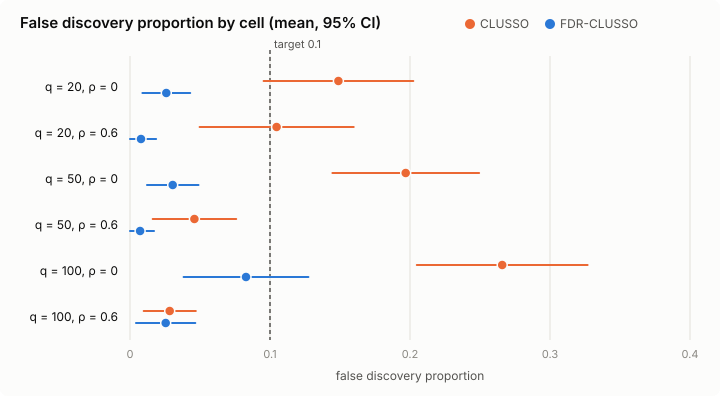
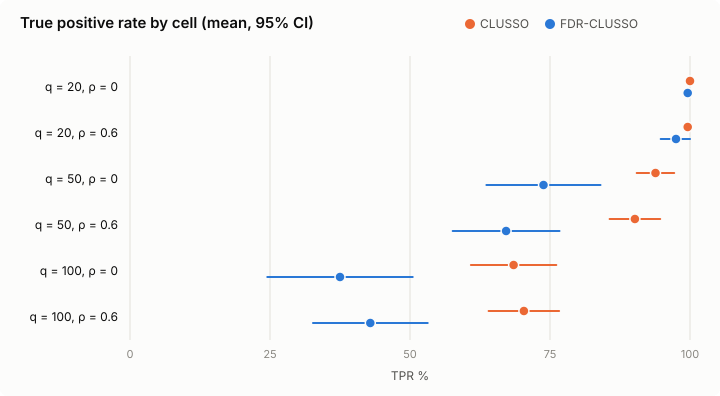
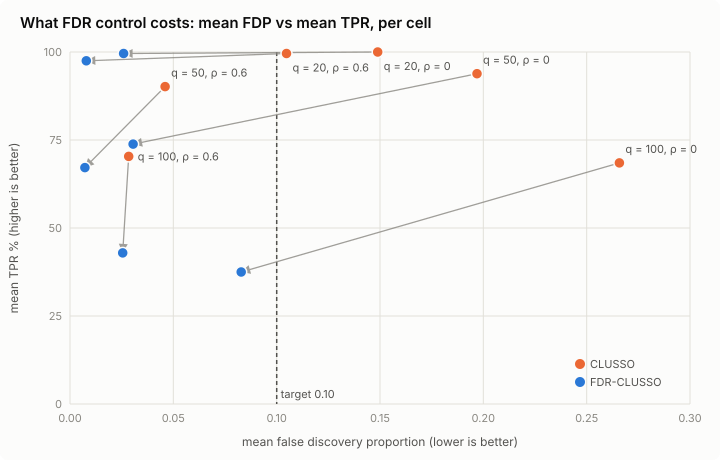

# FDR-CLUSSO vs CLUSSO: preliminary results, 2026-11-09

**Question:** wrapping CLUSSO in PS-Fdr (He et al.) is meant to hold the false
discovery rate (FDR) at 10%. Across the Random CLUSSO paper's simulation
settings, does it, and what does it cost?

**Short answer (preliminary, 30 replications per setting):**

- **FDR is held in every setting.** FDR-CLUSSO's mean false discovery
  proportion (FDP) is 0.007–0.083, under the 0.10 target in all 6 settings.
  CLUSSO alone is clearly over it in 3 of 6 (0.15, 0.20, 0.27) and right at
  it in a fourth (0.105).
- **It's conservative.** In 5 of 6 settings FDP sits at 0.01–0.03, well under
  0.10. Only the hardest setting (q = 100, ρ = 0) comes close to the target, at
  0.083.
- **The price is power, and it grows with q.** There's no significant loss at
  q = 20 (TPR 98–100%). At q = 50 it's 20–23 points and at q = 100 it's 27–31
  points, all with p < 0.001. FDR-CLUSSO never found more real features than
  CLUSSO on any of the 180 datasets.
- **The benefit depends on correlation.** At ρ = 0 CLUSSO over-selects and
  FDR-CLUSSO fixes it. At ρ = 0.6 CLUSSO's CV picks a large λ and is already
  under 0.10 (q = 50: 0.046, q = 100: 0.028). There FDR-CLUSSO mostly just costs
  power. At q = 100, ρ = 0.6 the FDP difference is zero (p = 0.8).

These numbers are preliminary. See [Caveats](#caveats) before quoting them.

## Setup

| | This run | Random CLUSSO paper |
|---|---|---|
| Data | Random CLUSSO design (`random_clusso_design.py`), simulated | same design |
| Subjects n | 200 | 200, 300, 400, 500, 1000 |
| Features q | 20, 50, 100 (40% real) | 20, 50, 100 |
| Feature correlation ρ | 0, 0.6 | 0, 0.3, 0.6, 0.9 |
| Replications | 30 per setting | 250 |
| λ grid for CV | paper's 18 values + 6–100 (`paper_wide`, REVIEW.md §13) | 18 values, 0.1–5 |
| Coefficient cut | 0.01 | 0.01 |
| PS-Fdr | B = 50 bootstraps, M = 100 permutations, target FDR 0.10, exact-k rule | — |
| Null λ ladder | coarse (13 steps) | — |

Methods: **CLUSSO** (CV-tuned, as it ships), **FDR-CLUSSO** (CLUSSO inside
PS-Fdr), **Naive** (subject-averaged lasso) and **Full Information** (CLUSSO on
the true latent tubules, an oracle). FDR-CLUSSO picks a set of features, so its
bias and MSE come from a structured-OLS refit on that set, which is how the
Random CLUSSO paper scores set-only methods.

The run is `grid_prelim/*.json` at commit `5815408` with a clean `src/`. It took
592 minutes for the q ≤ 50 cells and 1,822 for the q = 100 cells, at 6 jobs.
Figures and tables come from `plot_prelim.py`, which reads only those files.

## 1. False discoveries

## 2. Power

## 3. The trade

Each arrow goes from CLUSSO to FDR-CLUSSO on the same 30 datasets.

## 4. Full table

Mean FDP has a 95% CI. TPR, FPR and |S| (number selected) are means. Bias (L1,
both scaled to total 1) and in-sample MSE are medians, as in the paper. Time is
the mean per run.

| Cell | Method | mean FDP [95% CI] | FDP ≤ 0.10 | TPR % | FPR % | |S| | bias (median) | in-sample MSE (median) | min per run |
|---|---|---|---|---|---|---|---|---|---|
| q = 20, ρ = 0 | CLUSSO | 0.149 [0.095, 0.202] | 11/30 | 100.0 | 14.4 | 9.7 | 0.119 | 181 | 0.07 |
| q = 20, ρ = 0 | **FDR-CLUSSO** | 0.026 [0.009, 0.043] | 23/30 | 99.6 | 1.9 | 8.2 | 0.094 | 185 | 17.83 |
| q = 20, ρ = 0 | Naive | 0.459 [0.389, 0.530] | 0/30 | 95.0 | 61.4 | 15.0 | 0.422 | 343 | 0.00 |
| q = 20, ρ = 0 | Full Information | 0.000 [0.000, 0.000] | 30/30 | 100.0 | 0.0 | 8.0 | 0.008 | 1 | 0.07 |
| q = 20, ρ = 0.6 | CLUSSO | 0.105 [0.050, 0.160] | 19/30 | 99.6 | 10.6 | 9.2 | 0.179 | 202 | 0.07 |
| q = 20, ρ = 0.6 | **FDR-CLUSSO** | 0.008 [0.000, 0.019] | 28/30 | 97.5 | 0.6 | 7.9 | 0.157 | 202 | 16.20 |
| q = 20, ρ = 0.6 | Naive | 0.457 [0.378, 0.537] | 4/30 | 97.5 | 68.1 | 16.0 | 0.651 | 405 | 0.00 |
| q = 20, ρ = 0.6 | Full Information | 0.000 [0.000, 0.000] | 30/30 | 100.0 | 0.0 | 8.0 | 0.011 | 1 | 0.08 |
| q = 50, ρ = 0 | CLUSSO | 0.197 [0.145, 0.249] | 9/30 | 93.8 | 17.1 | 23.9 | 0.387 | 900 | 0.27 |
| q = 50, ρ = 0 | **FDR-CLUSSO** | 0.031 [0.012, 0.049] | 27/30 | 73.8 | 1.6 | 15.2 | 0.405 | 1059 | 45.77 |
| q = 50, ρ = 0 | Naive | 0.385 [0.319, 0.451] | 2/30 | 88.3 | 40.0 | 29.7 | 0.580 | 3077 | 0.00 |
| q = 50, ρ = 0 | Full Information | 0.000 [0.000, 0.000] | 30/30 | 100.0 | 0.0 | 20.0 | 0.009 | 1 | 0.17 |
| q = 50, ρ = 0.6 | CLUSSO | 0.046 [0.016, 0.076] | 26/30 | 90.2 | 3.2 | 19.0 | 0.438 | 1049 | 0.19 |
| q = 50, ρ = 0.6 | **FDR-CLUSSO** | 0.007 [0.000, 0.017] | 29/30 | 67.2 | 0.2 | 13.5 | 0.737 | 1171 | 27.88 |
| q = 50, ρ = 0.6 | Naive | 0.400 [0.319, 0.481] | 6/30 | 78.0 | 40.3 | 27.7 | 0.795 | 3697 | 0.00 |
| q = 50, ρ = 0.6 | Full Information | 0.000 [0.000, 0.000] | 30/30 | 100.0 | 0.0 | 20.0 | 0.014 | 1 | 0.20 |
| q = 100, ρ = 0 | CLUSSO | 0.266 [0.205, 0.327] | 8/30 | 68.5 | 15.9 | 37.0 | 0.830 | 3878 | 1.41 |
| q = 100, ρ = 0 | **FDR-CLUSSO** | 0.083 [0.038, 0.127] | 20/30 | 37.5 | 1.3 | 15.8 | 1.550 | 5917 | 184.29 |
| q = 100, ρ = 0 | Naive | 0.413 [0.354, 0.473] | 1/30 | 54.3 | 26.2 | 37.5 | 0.896 | 36497 | 0.00 |
| q = 100, ρ = 0 | Full Information | 0.000 [0.000, 0.000] | 30/30 | 100.0 | 0.0 | 40.0 | 0.015 | 2 | 1.13 |
| q = 100, ρ = 0.6 | CLUSSO | 0.028 [0.010, 0.047] | 28/30 | 70.3 | 1.4 | 29.0 | 0.776 | 3694 | 1.84 |
| q = 100, ρ = 0.6 | **FDR-CLUSSO** | 0.025 [0.004, 0.047] | 27/30 | 42.9 | 0.4 | 17.4 | 1.350 | 4616 | 152.15 |
| q = 100, ρ = 0.6 | Naive | 0.396 [0.320, 0.472] | 5/30 | 49.8 | 23.3 | 33.9 | 1.048 | 23774 | 0.00 |
| q = 100, ρ = 0.6 | Full Information | 0.000 [0.000, 0.000] | 30/30 | 100.0 | 0.0 | 40.0 | 0.017 | 1 | 1.72 |

Paired differences on the same datasets (Wilcoxon signed-rank p):

| Cell | Δ FDP (FDR − CLUSSO) [95% CI] | p | Δ TPR [95% CI] | p | FDR-CLUSSO TPR lower / same / higher |
|---|---|---|---|---|---|
| q = 20, ρ = 0 | -0.123 [-0.170, -0.076] | 0.0003 | -0.4 [-1.2, 0.4] | 0.3 | 1 / 29 / 0 |
| q = 20, ρ = 0.6 | -0.097 [-0.149, -0.044] | 0.003 | -2.1 [-4.7, 0.6] | 0.1 | 3 / 27 / 0 |
| q = 50, ρ = 0 | -0.166 [-0.217, -0.116] | 4e-05 | -20.0 [-28.0, -12.0] | 0.0002 | 18 / 12 / 0 |
| q = 50, ρ = 0.6 | -0.039 [-0.065, -0.012] | 0.003 | -23.0 [-30.1, -15.9] | 6e-05 | 21 / 9 / 0 |
| q = 100, ρ = 0 | -0.183 [-0.240, -0.126] | 2e-05 | -31.0 [-37.8, -24.2] | 8e-06 | 26 / 4 / 0 |
| q = 100, ρ = 0.6 | -0.003 [-0.028, 0.022] | 0.8 | -27.4 [-32.6, -22.2] | 3e-06 | 29 / 1 / 0 |

**Prediction:** FDR-CLUSSO's in-sample MSE is about the same as CLUSSO's at
q = 20, and 12–53% higher at q ≥ 50, because the refit uses fewer features.
Bias roughly follows the same pattern. Naive is worse than both everywhere. Full
Information shows the ceiling: it's near-perfect, so most of CLUSSO's error
comes from clustering, not from selection.

**Cost:** FDR-CLUSSO takes 16–184 minutes per dataset, against under 2 for
CLUSSO.

## 5. Why FDR-CLUSSO is under the target

PS-Fdr's own FDR estimate at the chosen set (`fdr_hat`, mean 0.015–0.075) is
close to the realized FDP in every setting. So the estimator isn't badly off.
The shortfall comes from the selection step, which takes the largest set whose
estimate is ≤ 0.10. Its estimate usually stops well short of 0.10, which
suggests the next feature in line would push it over. In 24 of 180 datasets
the estimate was exactly 0.

Two things rule out the obvious suspects:

- **The coarse ladder:** it's known to make FDP slightly *higher* (+0.006,
  REVIEW.md §9), not lower. The 40-step ladder should be at least as
  conservative.
- **The design:** the old design (`stage6`, n = 300, q = 50, 20% real) gave an
  FDP of 0.113. This design has 40% real features and more tubules per subject.
  Whether that alone explains the gap is open.

## Caveats

- **30 replications, not 250.** CIs on mean FDP are about ±0.02–0.06.
- **n = 200 only**, and only ρ = 0 and 0.6. No trend across n yet.
- **Coarse null ladder.** Use the 40-step ladder for reported numbers.
- **Simulated data**, Random CLUSSO's design. No real data yet.
- **Conditional on the clustering**, which was perfect (accuracy 1.0) in every
  dataset here.
- **CLUSSO's λ still sometimes hits the wide grid's top (100):** in 8 of 30
  datasets in each q = 100 setting, and 2 of 30 at q = 50, ρ = 0.6. So CLUSSO's
  q = 100 numbers are partly set by where the grid ends.
- **The 0.01 coefficient cut decides CLUSSO's support** in 100% of q = 100
  datasets and 30–77% elsewhere (REVIEW.md §6). That's part of CLUSSO as the
  paper runs it, but it means CLUSSO's TPR and FPR at q = 100 reflect the cut
  as much as the lasso.

## Next

1. The 40-step ladder on the q = 50 and q = 100, ρ = 0 settings, to confirm the
   FDP numbers. These are the ones where FDR-CLUSSO matters.
2. Find out why it's conservative (§5). If it's the discreteness of the
   selection step, it's a property of PS-Fdr. If it's the design, then
   ρ = 0.3 and other sparsities will show it.
3. More n (300, 500) and ρ (0.3, 0.9) once cost allows. Each q = 100 cell took
   14–17 hours.
