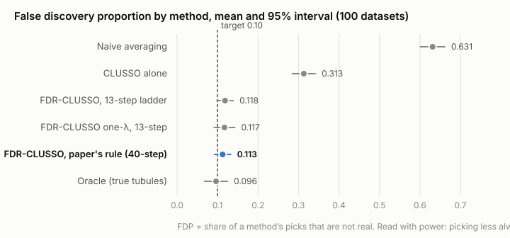
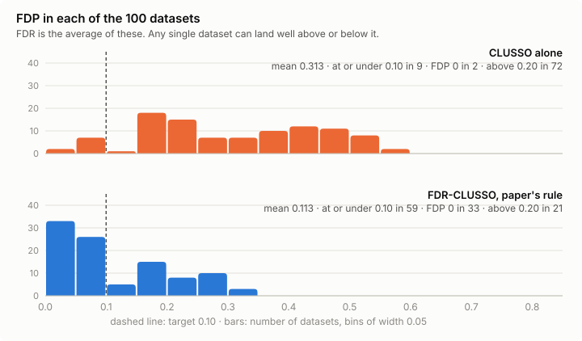
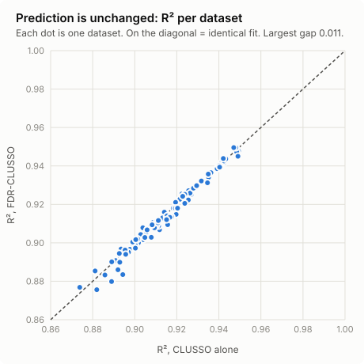

# FDR-CLUSSO results, 2026-10-27

**Question:** if you wrap CLUSSO in PS-Fdr (He et al.), does it keep the false
discovery rate at the 10% target, and what does that cost?

**Short answer:** in this simulation setting, yes, approximately. FDR-CLUSSO
brings CLUSSO's false discovery rate from **31% down to 11%**, which is close to
the 10% target and close to an oracle that sees the true tubules. It costs a
little power, and **prediction accuracy doesn't change.** That's evidence, not a
guarantee. See [What this does and doesn't show](#what-this-does-and-doesnt-show).

Every number below is read from two runs (see `RUNS.md`):

- `stage6_exactk_fine_reps100.json`: the paper's rule on its original 40-step
  λ ladder, plus the controls. **This is the headline run.**
- `stage5_reps100.json`: the same 100 datasets on the faster 13-step ladder,
  and the only run with the one-λ variant.

Figures come from `plot_stage6.py`, which reads only those files.

## Setup

100 simulated datasets. Each has 300 subjects, about 40 tubules per subject, 50
image features, and **10 features that truly matter**. The design matches the
CLUSSO paper's base case (n=300, q=50, 80% of coefficients zero). Target
FDR q = 0.10; PS-Fdr uses B=50 bootstraps and M=100 permutations, as in He et
al. Dataset i is the same simulated data in both runs.

Methods compared:

| method | what it is |
|---|---|
| Naive averaging | lasso on each subject's tubule averages (CLUSSO paper's baseline; He et al.'s CV-lasso) |
| CLUSSO alone | CV-tuned CLUSSO, no FDR control |
| **FDR-CLUSSO** | CLUSSO inside PS-Fdr, using the paper's null rule ("exact-k") |
| FDR-CLUSSO one-λ | a cheaper variant: one λ for every fit |
| Oracle | CLUSSO's estimator on the *true* latent tubules. It can't exist in practice and is here as a ceiling. |

## 1. False discoveries

| method | mean FDP | 95% interval | median FDP | datasets ≤ 0.10 | power | picks | false picks | missed real |
|---|---|---|---|---|---|---|---|---|
| Naive averaging | 0.631 | [0.601, 0.661] | 0.697 | 0 | 0.979 | 30.4 | 20.57 | 0.21 |
| CLUSSO alone | 0.313 | [0.284, 0.342] | 0.310 | 9 | 0.975 | 14.9 | 5.12 | 0.25 |
| **FDR-CLUSSO, paper's rule (40-step)** | **0.113** | **[0.093, 0.132]** | **0.091** | **59** | **0.933** | **10.6** | **1.31** | **0.67** |
| FDR-CLUSSO, 13-step | 0.118 | [0.098, 0.138] | 0.095 | 55 | 0.934 | 10.7 | 1.39 | 0.66 |
| FDR-CLUSSO one-λ, 13-step | 0.117 | [0.092, 0.143] | 0.091 | 65 | 0.956 | 11.1 | 1.52 | 0.44 |
| Oracle | 0.096 | [0.068, 0.125] | 0.000 | 70 | 1.000 | 11.5 | 1.46 | 0.00 |

FDP is the share of a method's picks that are not real. Power is the share of
the 10 real features it found.

- **FDR-CLUSSO removes about 4 of every 5 false picks** (5.1 → 1.3 per
  dataset), at the cost of missing about 0.4 more real features (power 0.975 →
  0.933).
- **Its interval covers the target.** 0.113 is 1.2 standard errors above 0.10,
  so this run doesn't show a failure to control FDR. The mean is still a little
  above 0.10, though, so it doesn't prove control either.
- **It's close to the oracle** (0.096), which has perfect inputs.

**FDR is an average, not a promise about one dataset.** FDR-CLUSSO had zero
false picks on 33 datasets, but above 20% on 21 of them (worst 0.33). CLUSSO
alone was above 20% on 72. A single real-data analysis can land well above
0.10 even when the method is working.

## 2. Prediction and coefficient accuracy

| method | β bias, mean | β bias, median | MSE, median | R², mean | R², min |
|---|---|---|---|---|---|
| Naive averaging | 0.529 | 0.481 | 214.4 | 0.859 | 0.500 |
| CLUSSO alone | 0.181 | 0.163 | 162.6 | 0.914 | 0.874 |
| **FDR-CLUSSO** | **0.159** | **0.140** | **168.0** | **0.913** | **0.876** |
| Oracle | 0.014 | 0.010 | 1.0 | 0.999 | 0.995 |

- **Prediction is unchanged.** R² is 0.914 vs 0.913, and no dataset differs by
  more than 0.011. Paired MSE is 3.3 higher for FDR-CLUSSO on average, higher
  on 58 datasets and lower on 42, which is a coin flip. The false features
  weren't helping prediction.
- **Coefficients get more accurate.** L1 bias of β falls 0.181 → 0.159
  (paired t = −5.1, better on 72 of 100). Fewer false features means less
  weight spread onto features that shouldn't have any.
- **Why raw MSE looks large and the oracle looks perfect.** Each dataset draws
  its own true coefficients, so Var(Y) ranges from 178 to 16,091 and raw MSE
  swings with it. That's why R² is the fair comparison. The oracle's MSE of 1.0
  is exactly the simulated noise variance. CLUSSO sees averages of about 40
  noisy sampled tubules instead of the true ones, and that measurement noise
  caps it near R² 0.91. Better feature selection can't remove it.
- **Naive averaging is unreliable.** It's fine on some datasets and collapses
  to R² 0.50 on others.

MSE is in-sample, as in the CLUSSO paper. FDR-CLUSSO's MSE and bias come from a
structured-OLS refit on its selected features, which is Random CLUSSO's
approach (`controls.py`).

## 3. The λ ladder

PS-Fdr's permuted arm walks a ladder of λ values. The paper's rule on its
original **40-step** ladder is the headline above. The faster **13-step**
ladder, used for speed since late September:

- **raises FDP slightly but consistently:** 0.113 → 0.118, paired difference
  0.006 (t = 2.0). It lowers the null bar on 92 of 100 datasets, but only
  changes what gets selected on 12.
- **halves the run time:** 4,548 s vs 2,299 s per dataset.

An earlier comparison on 20 datasets made this look bigger (FDP 0.138 → 0.157).
Those 20 turned out to be an unusually hard draw. On the 40-step ladder they
average 0.138, against 0.106 for the other 80.

**Recommendation:** use the 40-step ladder for anything reported, and keep 13
steps for quick exploration. Every run file now records which one it used.

## 4. Checks that passed

- The controls (naive, CLUSSO alone, oracle) are identical across both runs on
  all 100 datasets.
- The first 20 datasets reproduce the September run (`stage4.json`) exactly.
- The λ grid never ran out on any fit (exhausted rate 0).

## What this does and doesn't show

**Shows:** in this setting, FDR-CLUSSO's false discovery rate sits at the 10%
target within the precision of 100 datasets, about two-thirds lower than
CLUSSO alone, with prediction unchanged.

**Doesn't show:**

1. **A guarantee.** PS-Fdr's own paper supports it by simulation, not proof.
   This is one more simulation, in one setting.
2. **Other settings.** Every dataset here has 10 of 50 features real, large
   effects, and independent features. He et al. test far sparser signals,
   smaller effects, and correlated features. Those are next (REVIEW.md
   section 10, stage 5 step 2).
3. **Clustering robustness.** Clustering was perfect here (accuracy 1.000), so
   holding it fixed cost nothing. Noisier tubules, the CLUSSO paper's σ_R
   sweep, are where that would start to matter.
4. **R parity.** The Python port of CLUSSO has never been checked against the
   R original on the same data.

## Files

| file | what |
|---|---|
| `stage6_exactk_fine_reps100.json` / `.log` | headline run, 40-step ladder |
| `stage6_report.md` | full analysis of that run, including the ladder comparison and checks |
| `stage5_reps100.json` / `.log` | 13-step ladder run, both FDR variants |
| `plot_stage6.py` | regenerates every figure from the run files |
| `figures/` | the three figures, plus cached Var(Y) for R² |
